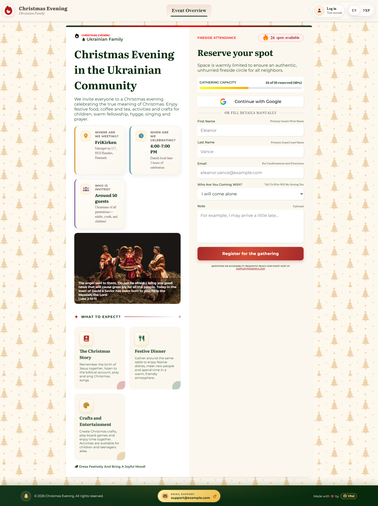

# Juleaften Event Registration Portal

A responsive event registration website for a Ukrainian community Christmas gathering. Guests can explore event details, see what to expect, check available capacity, and register or join the waitlist. The interface supports English and Ukrainian.

## Screenshots

### Desktop



### Mobile


## Features

- Event information, location and time details, and configurable expectation cards.
- Registration form with live capacity information and waitlist state.
- Google sign-in, account-aware registration views, and email verification.
- English and Ukrainian localization.
- Responsive layouts for desktop and mobile screens.
- Configurable support email address.

## Technology

- Vue 3 with the Composition API
- Vite
- Vue I18n
- Axios for API requests

## Getting started

Requirements: Node.js `^22.18.0` or `>=24.12.0` and npm.

```sh
npm install
```

Create a `.env.local` file in the project root:

```dotenv
VITE_API_URL=http://localhost:8080
VITE_EMAIL_SUPPORT=support@example.com
```

`VITE_API_URL` is the backend base URL. `VITE_EMAIL_SUPPORT` is optional and is
used for the support links in the registration form and footer. Vite exposes
variables prefixed with `VITE_` to client-side code, so do not put secrets in
them.

Start the development server:

```sh
npm run dev
```

Build and preview the production bundle:

```sh
npm run build
npm run preview
```

## Backend and authentication

The frontend API client sends requests with credentials. Google sign-in redirects
to `{VITE_API_URL}/oauth2/authorization/google`. After authentication, the
backend should establish the session with an `HttpOnly` cookie and redirect back
to the frontend. The app checks `GET /auth/me` to load the current user; the
browser intentionally cannot read an `HttpOnly` cookie directly.

For cross-origin deployments, configure CORS to allow credentials from the exact
frontend origin and set cookie attributes appropriate to the deployment. Do not
put session tokens in redirect URLs or browser-readable storage.
